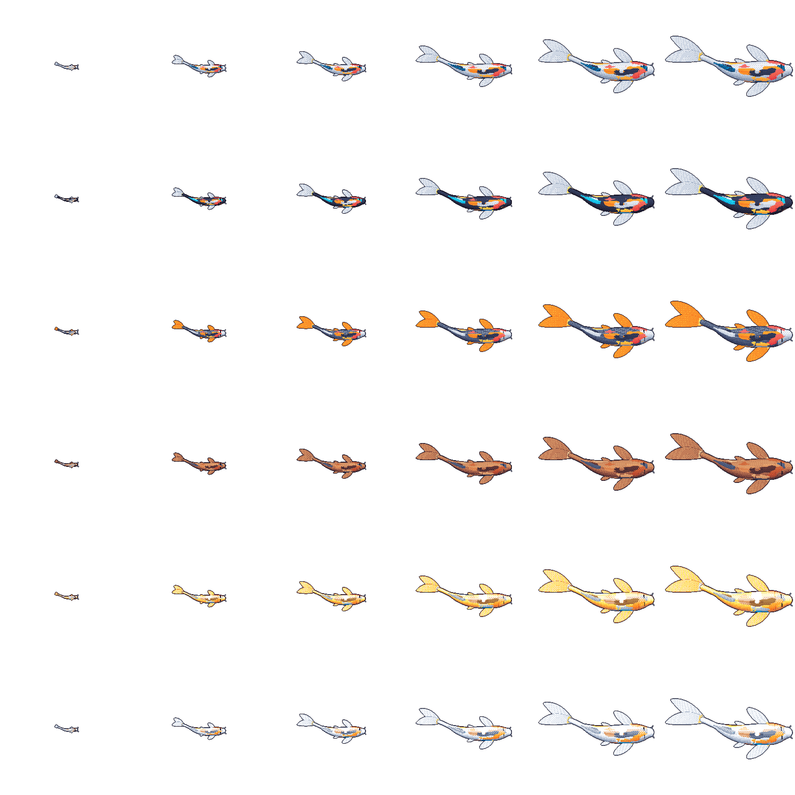
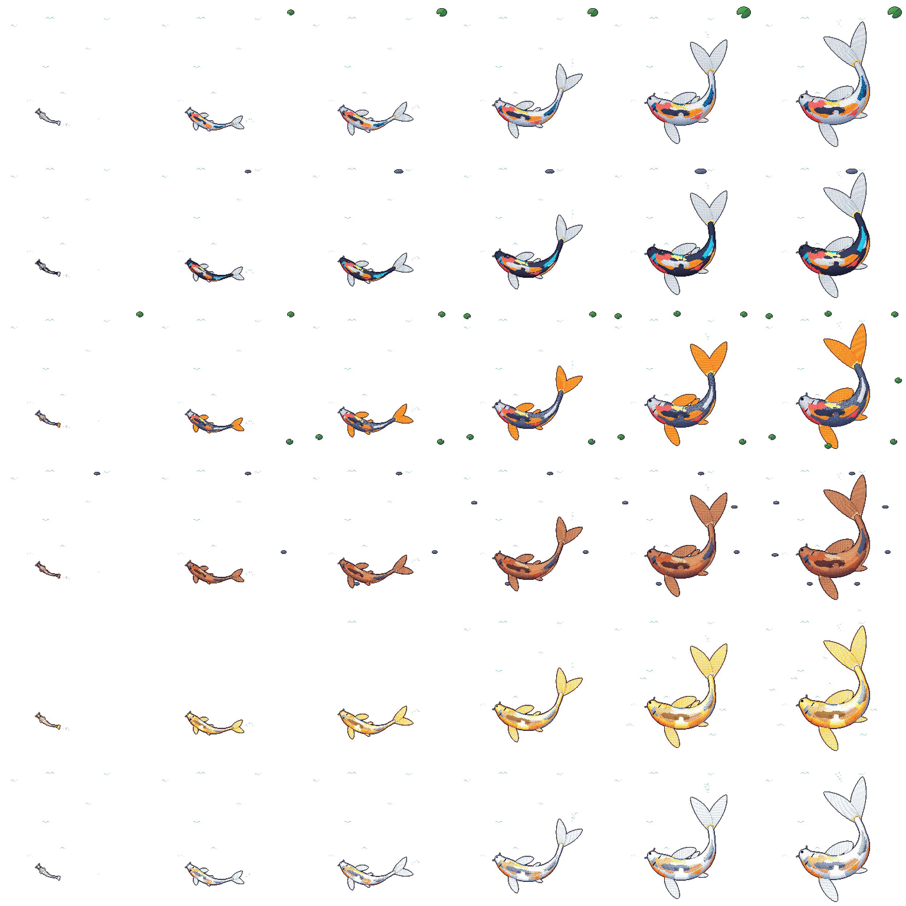

# Git koi

Git koi draws a pixel-art koi from a GitHub account's public activity. Its
languages color it, its contributions grow it, its streaks mark it, the day that
just ended decides how it swims, and the week's issues and pull requests float
lily pads and settle rocks around it. A nightly workflow puts the koi on a
profile README as a looping GIF, the same tool runs from the command line, and
the Rust library underneath is published on crates.io.

<p align="center">
  
</p>

<picture>
  <source media="(prefers-color-scheme: dark)" srcset="docs/bodies-dark.png" />
  
</picture>

<picture>
  <source media="(prefers-color-scheme: dark)" srcset="docs/pond-dark.png" />
  
</picture>

Down the rows, the six bodies, white, black, Asagi, tea, gold, and platinum;
across the columns, growth from no contributions to a hundred thousand; and in
each row one element of the pond rising alongside. Everything in the picture
comes from the account's public activity:

| Element     | Activity                                          | Levels                                                       |
| ----------- | ------------------------------------------------- | ------------------------------------------------------------ |
| Colors      | Primary languages of its public repositories      | Each language's GitHub color becomes a koi pigment           |
| Size        | Total contributions                               | Young by 1,500, adult by 12,750, full grown by 100,000       |
| Fin marks   | The current weekly streak                         | Build over 13 weeks, fade for 6 after the streak ends        |
| Color depth | The longest weekly streak                         | Dull to normal by 4 weeks, vivid by 52, glinting by 208      |
| Movement    | The day that just ended                           | Rest, surface feeding, dart, or cruise                       |
| Lily pads   | Issues opened, each of the last seven days        | One per day; 1 small, 2 to 3 medium, 4 or more large         |
| Rocks       | Pull requests opened, each of the last seven days | One per day, sized the same way                              |
| Water marks | Contributions in the last seven days              | None at 0, about 8 at 20, 20 at 100 or more                  |
| Wake        | Contributions on the day that just ended          | A quarter at 0, full at 10 or more, times the day's movement |

## Repository Structure

```text
.
├── .github/      workflows, issue forms, and Dependabot
├── docs/         the getting-started guide and the render sheets
├── examples/     the profile workflow and the koi library generator
├── src/          the library and the git-koi command
├── tests/        the public-boundary tests and their fixtures
└── action.yml    the GitHub Action
```

## Usage

### Requirements

- For a koi on your profile README: a GitHub account. The Action runs in your
  profile repository's workflow with its built-in token.
- For the command line: a binary from the
  [releases page](https://github.com/yalongwastaken/git-koi/releases), or Rust
  at or above the `rust-version` in [Cargo.toml](Cargo.toml), plus the
  [GitHub CLI](https://cli.github.com), authenticated.
- For the library: Rust at or above that same version.

[docs/getting-started.md](docs/getting-started.md) walks through all three: the
Action in a profile workflow, the command line, and the library. The API is
documented on [docs.rs](https://docs.rs/git-koi).

## Author

**Anthony Yalong**

- Email: yalong.anthony123@gmail.com
- GitHub: [@yalongwastaken](https://github.com/yalongwastaken)

## License

MIT. See [LICENSE](LICENSE).
